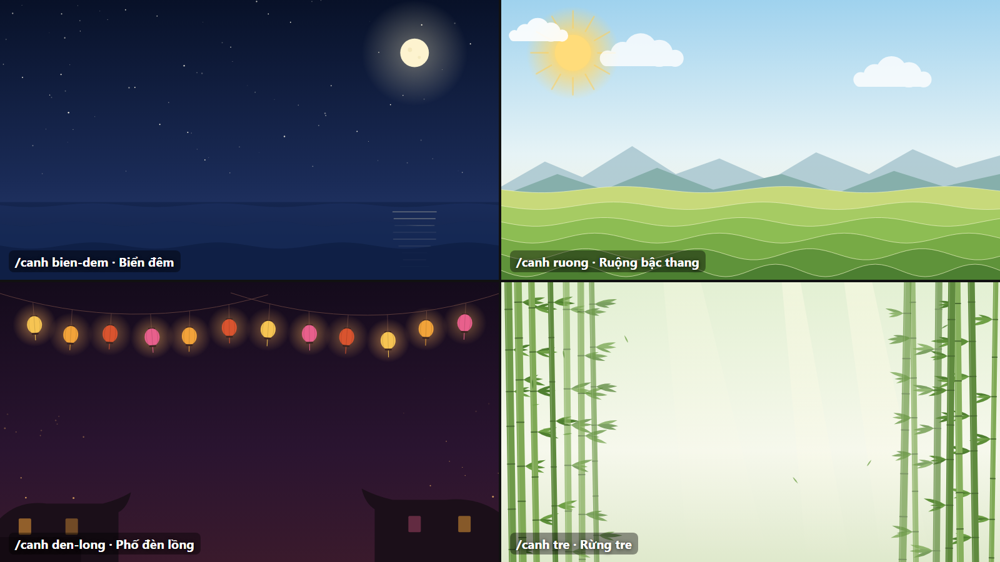

# vibe-scenes

**Hình nền động phong cách Việt Nam cho công cụ code AI.** Bản đầu tiên dành cho **Claude Code** (tab Code của app Claude Desktop và app điện thoại).



> Dự án cá nhân, **không chính thức**, không liên quan tới Anthropic.

## Cài đặt (1 dòng)

Trong terminal, ở dấu nhắc của Claude Code:

```
/plugin install vibe-scenes --marketplace luutheviet/vibe-scenes
```

Trả lời `y` để thêm marketplace, chọn phạm vi **user** (dùng cho mọi phiên).

Hoặc từ shell:

```bash
claude plugin install vibe-scenes --marketplace luutheviet/vibe-scenes
```

Trong **app Claude Desktop** (tab Code): bấm **+** cạnh ô chat → **Plugins** → **Add marketplace** → nhập `luutheviet/vibe-scenes` → **Add plugin**.

## Dùng

| Lệnh | Cảnh |
|---|---|
| `/scene` | Mở bảng chọn có ảnh thu nhỏ |
| `/scene bien-dem` (`/scene trang`) | 🌙 Biển đêm: trăng, sao lấp lánh, sao băng, sóng trôi |
| `/scene ruong` | 🌾 Ruộng bậc thang: nắng sớm, mây trôi, đàn chim |
| `/scene den-long` (`/scene hoi an`) | 🏮 Phố đèn lồng: đèn đung đưa, đốm lửa bay, mái ngói |
| `/scene tre` | 🎋 Rừng tre: tre đung đưa, nắng xuyên lá, lá rơi |
| `/scene ha-long` (`/scene suong`) | 🌫️ Vịnh sương sớm: đảo đá vôi trong sương, thuyền buồm trôi xa |
| `/scene sen` | 🪷 Đầm sen: lá sen nổi, hoa sen khẽ đung đưa, gợn nước |
| `/scene nui` | 🏔️ Núi đêm: núi Tây Bắc chồng lớp, sương trôi, đèn nhà sàn |
| `/scene hoa-dang` | 🏮 Hoa đăng: đèn hoa đăng trôi chậm trên sông đêm |
| `/scene kinh` | 🫧 Kính lỏng: nền pastel loang, dải kính cong và giọt kính khúc xạ (sáng) |
| `/scene kinh-dem` | 🫧 Kính lỏng đêm: cùng phong cách kính trên nền đêm xanh tím |
| `/scene off` | Tắt, về giao diện gốc |

Gõ tên có dấu hay không dấu đều được. Cảnh đã chọn được nhớ cho các phiên sau, và được áp lại khi `/clear`, resume hay fork. Mỗi cảnh có bảng màu riêng cho cả app (nền, chữ, màu nhấn).

> Khi mở một phiên mới, app hiện giao diện gốc trong lúc tiến trình Claude Code của phiên đó khởi động. Hình nền hiện ngay khi plugin được nạp: đây là giới hạn của app, plugin không vẽ được trước khi nó chạy.

## Vì sao yên tâm dùng

- **API chính thức:** dùng hệ thống plugin/mod của Claude Code (`$.theme.set` + `Backdrop`). **Không** cần Developer Mode, **không** mở DevTools, **không** dán script.
- **Không mạng, không script:** mỗi cảnh chỉ là SVG + CSS animation. Plugin không gọi mạng, không chạy lệnh, không đọc file hay hội thoại của bạn. Có test tự động chặn `<script>`, `on…=`, `href=` và URL ngoài trong SVG.
- **Chỉ lưu 1 thứ:** `{ scene: "<tên cảnh>" }` trong kho riêng của plugin.
- **Ít mã, đọc hết được:** khoảng 1.100 dòng (không tính `make-colors.js` sinh tự động) trong [`claude-code/hooks/`](claude-code/hooks/).
- Tôn trọng chế độ **giảm chuyển động** của hệ điều hành: khi bật, cảnh đứng yên.

## Tự tạo cảnh

Mọi cảnh nằm trong [`claude-code/hooks/scenes.ts`](claude-code/hooks/scenes.ts):

1. Viết hàm `drawXxx()` trả về `{ defs, style, body }`: phần thân SVG trong khung 1600×900 và CSS animation. Xem `drawSeaNight` làm mẫu.
2. Thêm một mục vào `SCENES`: `id`, `name`, `desc`, `alias`, `mode` (`light`/`dark`), `palette` (màu nền, chữ, màu nhấn), `glass` (độ mờ của khung chat phủ lên nền), `draw`.
3. Giữ chi tiết ở mép trên và hai bên; để trống giữa màn hình (chữ) và mép dưới (ô chat).

Nguyên tắc "đọc chữ trước" (4 cảnh mới tuân theo):

- Vùng chữ gần như một màu: độ lệch chuẩn độ sáng ở giữa màn hình không quá 0,04 (thang 0–1).
- Chuyển động chậm, chu kỳ từ 14 giây trở lên, biên độ nhỏ, không nhấp nháy.
- Chỉ animate `transform` và `opacity`, không dùng `filter`.
- Bảng màu: `text-primary` đạt ít nhất 7:1 trên mọi nền, `text-muted` ít nhất 4,5:1 trên `surface-0` và `surface-2`. Test tự động kiểm tra điều này.
- Id trong `<defs>` có tiền tố riêng của cảnh.

Giới hạn: SVG tối đa 131.072 ký tự, không script, không tải gì từ ngoài.

Kiểm tra trước khi gửi PR (cần Claude Code 2.1.325 trở lên; bản cũ hơn báo `no loaded plugin provides $.theme` ở các test dùng theme):

```bash
claude plugin validate claude-code
```

```bash
claude plugin test claude-code
```

## Hỗ trợ ở đâu

| Nơi dùng | Hình nền |
|---|---|
| App Claude Desktop, tab Code | ✅ Toàn cửa sổ |
| App Claude trên điện thoại (xem phiên Claude Code) | ✅ Toàn màn hình |
| Claude Code trong terminal / VS Code | ➖ Chỉ lưu lựa chọn (các nơi này không vẽ hình nền) |
| claude.ai (tab Chat) | ❌ Không có API chính thức |
| Codex và công cụ khác | 🔜 Dự định |

## Cấu trúc

```
.claude-plugin/marketplace.json   để cài bằng 1 dòng
claude-code/                      plugin cho Claude Code
  hooks/register.tsx              lệnh /scene, bảng chọn, vẽ hình nền
  hooks/scenes.ts                 8 cảnh SVG + bảng màu
  hooks/make-colors.js (.d.ts)    dựng bảng màu (từ Claude Code, xem dưới)
  tests/scenes.test.tsx           test
assets/preview.png                ảnh xem trước
```

## Giấy phép

[MIT](LICENSE), trừ `claude-code/hooks/make-colors.js` và `make-colors.d.ts`: hai file này được chép nguyên văn từ bộ công cụ tạo plugin của Claude Code theo hướng dẫn của nó, và **không** thuộc phạm vi giấy phép MIT của repo.

---

<details>
<summary><b>English</b></summary>

**vibe-scenes** adds animated, Vietnamese-themed full-window backdrops and matching color palettes to **Claude Code** (the Code tab of the Claude Desktop app, and the mobile app). Unofficial, not affiliated with Anthropic.

Install at a Claude Code prompt:

```
/plugin install vibe-scenes --marketplace luutheviet/vibe-scenes
```

Then run `/scene` to pick a scene: night sea (`bien-dem`), rice terraces (`ruong`), lantern street (`den-long`), bamboo forest (`tre`), misty bay (`ha-long`), lotus pond (`sen`), mountain night (`nui`), lantern river (`hoa-dang`), liquid glass (`kinh`, `kinh-dem`), or `off`.

It uses the official plugin API (`$.theme.set` + `Backdrop`): no Developer Mode, no DevTools, no pasted scripts. Scenes are plain SVG + CSS animation; the plugin makes no network calls, runs no commands and reads none of your files or conversations. Tests reject scripts, event handlers and external URLs in every scene. Codex and other tools are planned.

MIT licensed, except `claude-code/hooks/make-colors.js` and `.d.ts`, copied verbatim from Claude Code's plugin-authoring kit and not covered by this repository's license.

</details>
